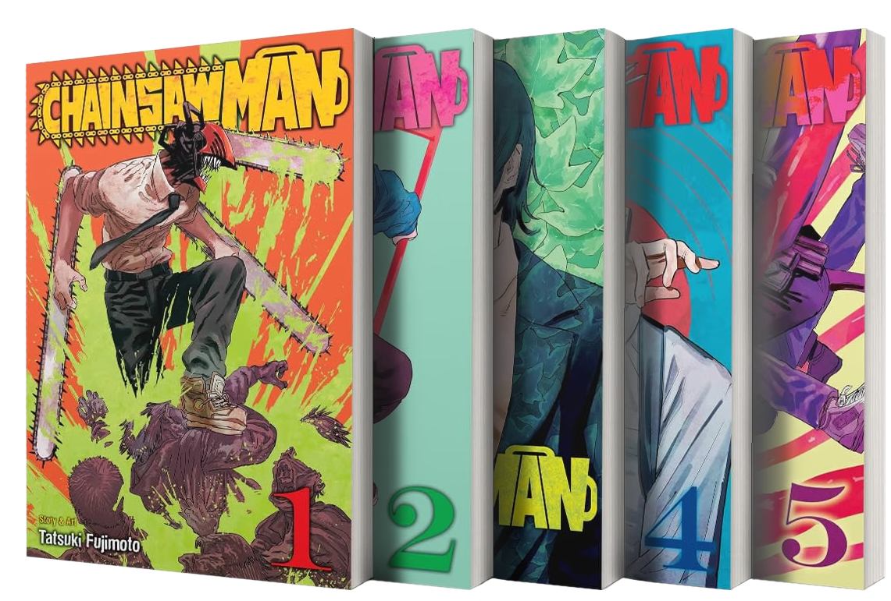

<!-- Section 1 -->
<section class="hero">
    

        

            
            
A broke devil hunter, a chainsaw devil, and a dream that is much smaller than it sounds.

            
Tatsuki Fujimoto's dark action series mixes gore, dark humor and surprising heart.

            

                <a class="btn btn-primary" href="#where-to-start">Read the Manga</a>
                <a class="btn btn-secondary" href="#where-to-start">Watch the Anime</a>
            

        

        

            
        

    

</section>

<!-- Custom CSS Section 1 (for section fade) -->
<section class="custom-section-1"> </section>

<!-- Section 2 -->
<section class="section section--dark">
    

        <h2 id="story-title">The Story</h2>
        

            

                
Denji is a teenager buried in debt and working as a devil hunter alongside his pet Pochita, who happens to be the Chainsaw Devil. His life is hard and his dreams are modest: a warm meal, a roof, and like every other teenger boy, a women's affection.

                
After being betrayed by the Yakuza and gruesomely murdered by the Zombie Devil, Denji merges with Pochita and becomes Chainsaw Man himself.

                
When a government agency led by a mysterious woman named Makima recruits him, he is pulled into a world full of devils, death, and secrets.

            

            

                
            

        

    

</section>

<!-- Custom CSS Section 2 (for section fade) -->
<section class="custom-section-2"> </section>

<!-- Section 3 -->
<section class="section">
    

        <h2 id="facts-title">Facts</h2>
        

            
<h3>Genre</h3>
A dark fantasy, action, & horror series mixed with plenty of gore, dark humour, and heart

            
<h3>Manga</h3>
Written and drawn by mangaka Tatsuki Fujimoto, and originally published in Shonen Jump

            
<h3>Anime</h3>
A 12-Episode anime series and a follow-up film produced and animated by MAPPA

            
<h3>Status</h3>
Manga is now offically finished in Japan but is awaiting release of the final two volumes in English

        

    

</section>

<!-- Custom CSS Section 1 (for section fade) -->
<section class="custom-section-1"> </section>

<!-- Section 4 -->
<section class="section section--dark" id="where-to-start">
    

        <h2 id="start-title">Where to Start</h2>
        

            

                <h3>Read The Manga</h3>
                
Start with Part 1 and read in volume order for the full story

                

                    <a class="btn btn-secondary" href="https://www.indigo.ca/search?q=Chainsaw+Man&sortBy=relevance&sortOrder=descending&page=1">Reading platform</a>
                

            

            

                <h3>Watch The Anime</h3>
                
The TV series adapts the manga but is yet to be finished

                

                    <a class="btn btn-secondary" href="https://www.crunchyroll.com/series/GVDHX8QNW/chainsaw-man">Chainsaw Man</a>
                    <a class="btn btn-secondary" href="https://www.crunchyroll.com/series/GNVHKN92K/chainsaw-man--the-movie-reze-arc">Chainsaw Man - The Movie: Reze Arc</a>
                

            

        

        

            <h3>Watching / Reading Order</h3>
            <ol>
                <li>Watch Chainsaw Man (season 1, or read volumes 1-5 of the manga)</li>
                <li>Watch Chainsaw Man - The Movie: Reze Arc (or read volume 6 of the manga)</li>
                <li>Continue with the manga: Finish Part 1 (volumes 1-11) and move onto Part 2 (volumes 12-24)</li>
            </ol>
        

    

</section>

<!-- Custom CSS Section 2 (for section fade) -->
<section class="custom-section-2"> </section>

<!-- Section 5 (blank section for spacing -->
<section class="custom-spacing-section"> </section>
